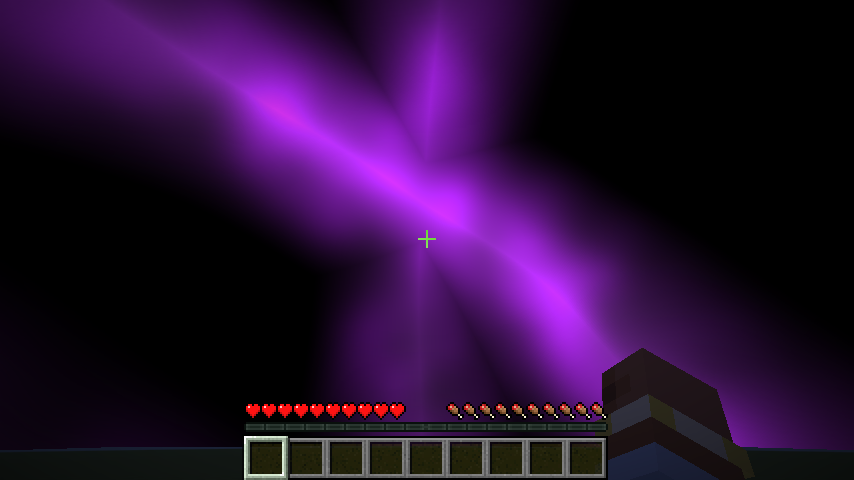
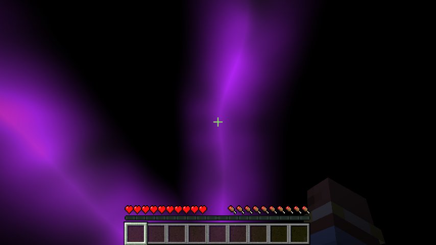
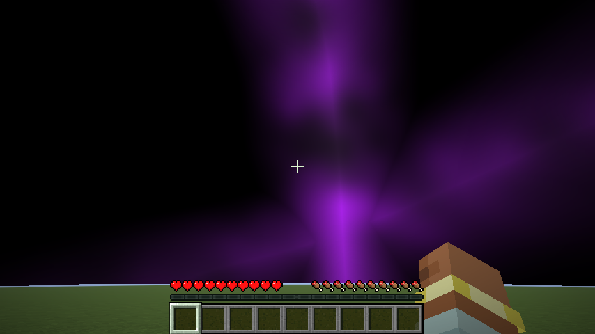

# Purple Cosmos Sky Pack

made by ways, discord: waystobe

a purple cosmos sky for minecraft 1.21.11. two versions, pick the one that fits your setup:

- Purple Cosmos Sky Pack.zip: works with the Nuit mod (the normal version, use this one with Fabric)
- Purple Cosmos Sky Pack OPTIFINE.zip: for OptiFine or a mod that reads optifine sky files

both are in the release. the `optifine` folder in this repo is the OptiFine version, the rest is the Nuit version.

